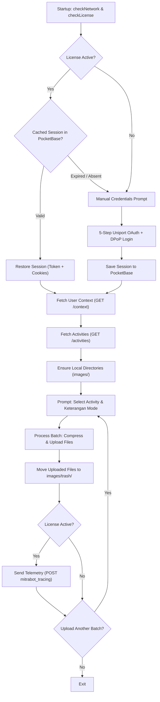

# Bot Pega Mitra

[](https://bun.sh)
[](LICENSE)
[](https://www.typescriptlang.org)

CLI automation tool for streamlining activity uploads on the Mitra portal.

---

## 📐 Key Features

- **Puppeteer-Free Direct API Client**: Replaced Chromium browser automation with direct HTTP calls (`UniportApiClient`), dramatically reducing memory consumption, execution latency, and binary size.
- **Uniport OAuth + RFC 9449 DPoP Handshake**: Full implementation of the upstream 5-step authentication flow using ECDSA P-256 cryptographic Proof-of-Possession tokens (`dpop.ts`).
- **PocketBase Auth Token Reuse**: Caches valid JWT sessions and session cookies in PocketBase (`mitrabot_sessions`) under active licenses, allowing instant passwordless login across sessions with graceful fallback on token revocation.
- **Live Batch Completion Telemetry**: Dispatches upload telemetry (`mitrabot_tracing`) upon completing each activity batch when a valid license is active.
- **Dynamic Context & Activity Discovery**: Automatically fetches user organizational contexts and assigned activities directly from the API—eliminating the need for static `jobs.json` files.
- **Native In-Memory Image Compression**: Leverages Bun's native `Bun.file().image()` API to resize and compress photos in memory before upload without writing temporary files to disk.
- **Realistic Browser Emulation**: Replicates Chrome desktop HTTP request headers (`headers.ts`) including `Sec-CH-UA`, navigation/fetch metadata, and referrer headers.
- **Interactive Terminal UX**: Modern interactive CLI built with `@clack/prompts`, featuring folder file counters, batch confirmation, customizable keterangan modes, and clean error reporting.
- **Standalone Binary Compilation**: Builds directly into a single Windows x64 executable (`dist/bot-pega-mitra.exe`) via `bun build --compile`.

---

## 🛠️ Architecture & Workflow



### Module Breakdown

| Module                  | Location                             | Description                                                                                                                                                |
| ----------------------- | ------------------------------------ | ---------------------------------------------------------------------------------------------------------------------------------------------------------- |
| **Bot Controller**      | [`src/bot.ts`](./src/bot.ts)         | Coordinates the CLI lifecycle, startup verification, prompt interactions, and batch loops.                                                                 |
| **API Client**          | [`src/api.ts`](./src/api.ts)         | Implements Uniport DPoP OAuth, user context/activities retrieval, two-step activity creation (`/mulai` -> `/selesai`), and automatic 401 session recovery. |
| **License & Sessions**  | [`src/license.ts`](./src/license.ts) | Handles license verification, PocketBase session caching (`mitrabot_sessions`), and telemetry dispatch (`mitrabot_tracing`).                               |
| **DPoP Cryptography**   | [`src/dpop.ts`](./src/dpop.ts)       | RFC 9449 ECDSA P-256 keypair generation, public JWK export, and DPoP proof generation with `ath` hashing.                                                  |
| **Browser Emulation**   | [`src/headers.ts`](./src/headers.ts) | Generates Chrome desktop browser headers and wraps fetch requests via `browserFetch`.                                                                      |
| **File & Image Engine** | [`src/files.ts`](./src/files.ts)     | Directory management, supported image filtering, native Bun in-memory image compression, and safe trash moving (`EXDEV` safe).                             |
| **Error Handling**      | [`src/error.ts`](./src/error.ts)     | Structured `ApiError`, verbose mode detection, error formatting, and persistent `error.log` tracking.                                                      |

---

## 📋 Prerequisites

- **Bun**: `>= 1.4.4` ([Installation Guide](https://bun.sh))
- **OS**: Windows, macOS, or Linux (compilation target defaults to Windows x64)

---

## ⚙️ Configuration (.env)

Create a `.env` file in the root directory (refer to [`.env.example`](./.env.example)):

```env
# Upstream Portal Target
BOT_URL="https://hcq.payrollq.id"

# Optional: Auto-fill login credentials (leave blank for interactive CLI prompt)
BOT_USERNAME=""
BOT_PASSWORD=""

# Optional: PocketBase License & Telemetry (injected automatically in production builds)
LICENSE_URL="https://your-pocketbase-server.com"
LICENSE_TOKEN="your-license-secret-token"
LICENSE_USER="your-license-identity-username"

# Optional: Verbose API error diagnostics
VERBOSE=false
```

---

## 📁 Directory Structure & Images Folder

Upon logging in, the bot synchronizes local folders under `images/` corresponding to each available activity:

```
PegaUploaderBot/
├── images/
│   ├── trash/                         # Successfully uploaded images are automatically moved here
│   ├── Kunjungan Toko/                # Drop images for 'Kunjungan Toko' here
│   ├── Display Produk/                # Drop images for 'Display Produk' here
│   └── ...
├── src/                               # TypeScript source code
├── test/                              # Bun test suites
├── openspec/                          # OpenSpec specifications
├── build.ts                           # Standalone binary build script
└── error.log                          # Appended error log for diagnostics
```

### Supported Image Formats

- `.jpg`, `.jpeg`, `.png`, `.webp`, `.heic`, `.avif`, `.bmp`, `.tiff`
- System/hidden files (such as `.DS_Store` or `Thumbs.db`) are automatically ignored.

### Image Optimization Rules

- **Images > 1920px width**: Resized to 25% of original width (`Math.round(width / 4)`) and compressed to JPEG at quality `75`.
- **Images <= 1920px width**: Kept at original dimensions and compressed to JPEG at quality `60`.
- All compression is performed entirely in memory.

---

## 🖥️ Usage

### Development Mode

Run the bot directly using Bun:

```bash
bun dev
```

Run with verbose API output:

```bash
bun dev --verbose
```

### Running Tests

Execute the comprehensive Bun unit test suite:

```bash
bun test
```

Perform TypeScript type checking without emitting:

```bash
bun x tsc --noEmit
```

### Compiling to Standalone Executable

Compile a standalone, minified Windows x64 binary:

```bash
bun run build
```

The output executable will be created at:

```
dist/bot-pega-mitra.exe
```

> **Note**: `build.ts` automatically embeds `LICENSE_URL`, `LICENSE_TOKEN`, and `LICENSE_USER` into the binary at compile time using Bun's `--define` feature.

---

## 🔄 User Workflow Step-by-Step

1. **Network & License Verification**: The bot verifies connection to `BOT_URL` and validates active license credentials against PocketBase (`LICENSE_URL`, `LICENSE_USER`, and `LICENSE_TOKEN`), verifying version support and active status.
2. **Authentication**:
   - If `BOT_USERNAME` is provided in `.env` and a cached session exists in PocketBase, it automatically restores the session.
   - Otherwise, you will be prompted for your Email/Username. If a valid cached session is found, password entry is skipped.
   - If no cached session exists, enter your password to perform the 5-step Uniport OAuth handshake. The session is then persisted to PocketBase.
3. **Select Organization Context**: If your account belongs to multiple company divisions/departments, select the target context.
4. **Select Activity**: Choose from the list of activities. Each option shows the current count of supported image files in its respective `images/<Activity>/` folder.
5. **Choose Keterangan Mode**:
   - **Mode Aktivitas** (default): Uses the activity name for every uploaded file's description.
   - **Mode Nama Berkas**: Uses the original file name (excluding extension) as the description.
6. **Confirm & Upload**:
   - The bot sequentially compresses each file and uploads it.
   - Successfully uploaded images are moved to `images/trash/`.
   - Failed images are preserved in the activity folder for subsequent retry, and errors are recorded in `error.log`.
7. **Telemetry & Repeat**: Upon batch completion, telemetry is dispatched to PocketBase, and you are prompted whether to upload another activity.

---

## 📄 License & Credits

- **Author**: Kevin Sandiho
- **License**: [GPL-3.0](LICENSE)
